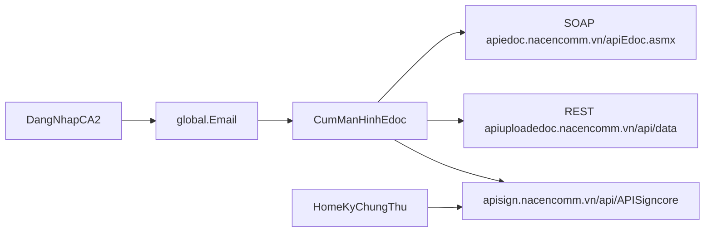

# Đưa chức năng edoc lên app CA2

Giữ nguyên app ký chứng thư hiện tại (hộp thư mobilesign, PIN, eKYC). Thêm một cụm màn hình **Tài liệu edoc** gọi cùng backend với web. Không nhúng WebView, không thay màn đăng nhập CA2.

Phiên edoc lấy từ `global.Email` sau khi đăng nhập CA2. Phase này không làm đẩy lô và không làm ký VNeID của edoc.

## Trạng thái

Cập nhật dòng tương ứng thành `done` khi xong bước đó, rồi commit cùng code của bước.

- [x] edoc-client: Thêm SOAP client, REST file client và session theo global.Email + PhanloaiTK
- [x] edoc-list: Màn danh sách tài liệu, xem PDF, nhật ký, xóa/hoàn tác, gán danh mục
- [x] edoc-sign: Ký mobilesign qua hash/ghép file, từ chối và phê duyệt ảnh. Không đưa ký VNeID của edoc
- [x] edoc-create: Tạo một tài liệu: upload, người ký, vùng ký, gửi
- [x] edoc-master: Danh mục và danh bạ cho PhanloaiTK = 1
- [x] edoc-settings: Template vùng ký, hồ sơ và đăng ký chứng thư VNeID. Chưa làm đẩy lô
- [x] edoc-upload: Upload bằng blob-util, gán `GanDMTailieu`, chỉ gửi khi thiết lập người ký, vùng ký và `GuiVB` đều > 0
- [x] edoc-view: Tải PDF về máy rồi xem, vì URL `GetFile` bị mã hóa hai lần trong `react-native-pdf`
- [x] edoc-pin: Ký mobilesign ngay trên màn tài liệu, nhập PIN rồi mới ghép chữ ký
- [x] edoc-after-sign: Sau khi ký chỉ xem file đã ký, ẩn ký mobilesign, phê duyệt ảnh và từ chối
- [x] edoc-ui: Header chung, danh sách gọn, màn tạo tài liệu theo ba bước

## Đã chỉnh sau khi chạy trên điện thoại

Các mục trên đã chạy được với tài khoản edoc có sẵn. Phần dưới là các chỗ phải sửa thêm để cả quy trình tạo, xem và ký chạy trên máy.

- Upload một file PDF bằng `react-native-blob-util`, kèm tên file thật. ASP.NET `Request.Files` trả `kq=-1` ("Không thấy file") nếu tên file rỗng. Sau `TaoVB` gọi `GanDMTailieu`, vì danh sách web và app chỉ đọc `v_VBChitiet_cn` theo email được gán. `Thietlaptaikhoanky`, `Thietlapvungky` và `GuiVB` chỉ được tính thành công khi kết quả lớn hơn 0.
- Xem tài liệu: `files.downloadPdf` tải `GetFile` vào cache rồi mở `file://`. Không đưa URL đã `encodeURIComponent` vào `Pdf.tsx`, vì component gọi `encodeURI` thêm một lần và máy chủ không tìm thấy file.
- Ký mobilesign ở lại `EdocDetail`. Trước `Guiyeucauky_Mobilesign`, bật `localHashSign` để thông báo `key=2` của yêu cầu này không mở popup hộp thư cũ và không rời màn. Ô PIN hiện trên chính màn tài liệu. Xác nhận PIN gọi `Ky_Mobilesign` với `Code` lấy từ danh sách chờ ký, `global.UUID` và `global.id` hoặc `global.idcts`. PIN đúng rồi mới gọi `GhepCKY`. Đóng ô PIN thì hủy. Thông báo ký từ nguồn khác vẫn đi luồng hộp thư cũ.
- Sau khi ghép xong, tải lại PDF đã ký và ẩn nút Ký mobilesign, Phê duyệt bằng ảnh, Từ chối. Mở lại tài liệu có `Trangthaiky = 1` của người đang đăng nhập cũng chỉ còn file và nhật ký.
- Giao diện edoc dùng header chung. Danh sách là thẻ, nút thao tác gọn. Tạo tài liệu chia ba bước: chọn PDF, chọn thư mục và danh mục, chọn người ký rồi khoanh vùng. Nút gửi nằm cố định phía dưới.

## Hai hệ đang chạy song song

- Web edoc khóa mọi nghiệp vụ bằng **email** trong SOAP, không dùng JWT cho các lệnh tài liệu. Ví dụ `LayDSVB_Choky` trong [edoc_moi/src/views/QuanLy/TaiLieu/TaiLieu.vue](edoc_moi/src/views/QuanLy/TaiLieu/TaiLieu.vue) chỉ gửi `<Email>`.
- App CA2 đã có `global.Email` sau đăng nhập chứng thư ([CA2-RS-main/screen/DangNhap/startLogin.jsx](CA2-RS-main/screen/DangNhap/startLogin.jsx)). Vào cụm edoc thì gọi `Laythongtintaikhoan` bằng email đó.
- Nếu email chưa có tài khoản edoc: báo rõ, không tự đăng ký. Đăng ký / quên mật khẩu / đăng nhập Google-Passkey-VNeID của web **không đưa lên app**, vì đã chốt dùng email CA2.
- `PhanloaiTK = 0`: chỉ xem và ký tài liệu được giao. `PhanloaiTK = 1`: thêm tạo một tài liệu, danh mục, danh bạ. Menu web đã khóa danh mục và danh bạ với loại `0` trong [edoc_moi/src/components/Menu.vue](edoc_moi/src/components/Menu.vue). Đẩy lô không làm trong phase này, kể cả với tài khoản loại `1`.

## Chức năng web và cách mang sang app

Giữ nguyên hợp đồng API. Viết client SOAP 1.2 (`application/soap+xml`) và parse `diffgr:diffgram`, vì web không có lớp API chung — mỗi màn tự ghép XML.

**Đưa lên native**

- Tài liệu: tab chờ ký, đã nhận, đã tạo, tất cả, thùng rác. Lọc theo danh mục, xóa / hoàn tác, gán danh mục, gửi mail, kiểm tra chữ ký (`VerifySignature`).
- Chi tiết: xem PDF (`GetFile`), nhật ký, từ chối (`TuchoiVB`), ký xong gửi mail.
- Ký: mobilesign (hash `HashPDFFile` rồi `Guiyeucauky_Mobilesign` / `GhepCKY`) và phê duyệt ảnh (`Pheduyet_Kydientu`). Ký lô mobilesign đã có trong [CA2-RS-main/utils/apiService.js](CA2-RS-main/utils/apiService.js). Luồng edoc phải đi qua hash/ghép file của `apiuploadedoc`, không ký thẳng hộp thư chứng thư.
- Tạo tài liệu (chỉ loại tài khoản `1`): chọn một file, thư mục, danh mục, người ký từ danh bạ, vùng ký, gửi (`TaoVB`, `Thietlaptaikhoanky`, `Thietlapvungky`, `GuiVB`).
- Danh mục và danh bạ: CRUD SOAP (`GetDMTailieu`, `ThemmoiDMTailieu`, `SuaDMTailieu`, `XoaDMTailieu`, `LayDSDanhba`, `Themmoidanhba`, `Suadanhba`, `Xoadanhba`).
- Cài đặt edoc: hồ sơ (`Capnhatthongtintaikhoan`), phương thức ký mặc định, template vùng ký (`templateThietLap.ts`), đăng ký chứng thư VNeID (gateway `providers` / `certificates/register` như [edoc_moi/src/components/setting/DangKyChungThuVneId.vue](edoc_moi/src/components/setting/DangKyChungThuVneId.vue)). Đăng ký chứng thư không gọi luồng ký hash VNeID. Passkey CA2 đã có ở [CA2-RS-main/screen/Passkey/DangKyPasskey.jsx](CA2-RS-main/screen/Passkey/DangKyPasskey.jsx), không làm lại QR web.

**Không đưa lên app trong phase này**

- Đẩy lô: [edoc_moi/src/views/QuanLy/DayLoTaiLieu2026.vue](edoc_moi/src/views/QuanLy/DayLoTaiLieu2026.vue) và [edoc_moi/src/components/daylo/DayLoTuyChinhTab.vue](edoc_moi/src/components/daylo/DayLoTuyChinhTab.vue). Không tạo nhiều văn bản một lúc, không import Excel người ký, không upload hàng loạt, không gọi `GuiYCKyLo`.
- Đăng nhập, đăng ký, quên mật khẩu, xác nhận email, đăng nhập Google, callback tạo phiên VNeID.
- Ký VNeID của edoc: `HashPDFFile_VNEID`, `GhepCKYVNEID`, và các gọi gateway `signings/hash`, `signings/polling`, `universal-links`, `certificates/list` trong [edoc_moi/src/views/QuanLy/TaiLieuChiTiet.vue](edoc_moi/src/views/QuanLy/TaiLieuChiTiet.vue). Màn ký file local `KyFileVneId` của CA2 giữ nguyên, không nối vào văn bản edoc.
- Ký bằng USB token (`Guiyeucauky_Token`, `Thietlapphuongthuckytoken`). Nếu tài khoản đang đặt mặc định token, app báo ký token chỉ thực hiện trên web; trên điện thoại ký edoc bằng mobilesign theo `global.idcts`.

## Cách gắn vào app

Thêm stack `Edoc` trong [CA2-RS-main/App.js](CA2-RS-main/App.js), lối vào từ Home. Không đổi tab Home / Tài khoản hiện tại, để hộp thư ký chứng thư không bị trộn với văn bản edoc.

Lớp mới, tách khỏi `apiService.js`:

- `utils/edoc/soap.js` — gọi `https://apiedoc.nacencomm.vn/apiEdoc.asmx`, parse XML. Cần thêm bộ parse XML (app chưa có).
- `utils/edoc/files.js` — `Upload`, `GetFolder`, `GetFile`, `VerifySignature`, `HashPDFFile`, `GhepCKY`, `Pheduyet_Kydientu` trên `https://apiuploadedoc.nacencomm.vn`. Không gọi `HashPDFFile_VNEID`, `GhepCKYVNEID` và `GuiYCKyLo`.
- `utils/edoc/session.js` — đọc `global.Email`, gọi `Laythongtintaikhoan`, lưu `PhanloaiTK` và phương thức ký mặc định.

Vẽ vùng ký tái sử dụng PDF viewer sẵn có ([CA2-RS-main/PDFViewer/index.tsx](CA2-RS-main/PDFViewer/index.tsx), `pdf-lib` đã có). Chọn file bằng `expo-document-picker`. Upload multipart bằng `react-native-blob-util`.

## Thứ tự làm

1. Client SOAP/REST và màn kiểm tra tài khoản theo email. Chưa có tài khoản thì dừng ở thông báo.
2. Danh sách tài liệu, xem PDF, nhật ký, xóa / hoàn tác, gán danh mục.
3. Ký một văn bản bằng mobilesign, rồi từ chối và phê duyệt ảnh. Không làm nút ký VNeID.
4. Tạo một tài liệu và gửi người ký, gồm chọn vùng trên PDF.
5. Danh mục và danh bạ cho `PhanloaiTK = 1`.
6. Template vùng ký, hồ sơ, phương thức ký mặc định, đăng ký chứng thư VNeID.

Mỗi bước xong phải chạy được trên app với một email CA2 đã có tài khoản edoc, và không đổi hành vi hộp thư ký chứng thư cũ.
